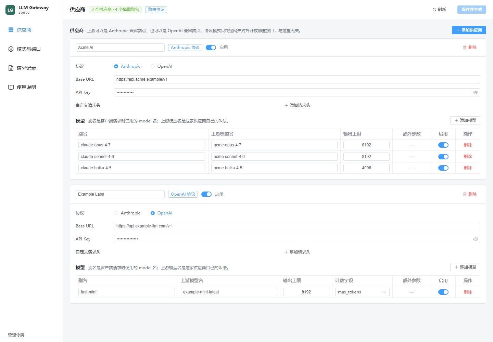
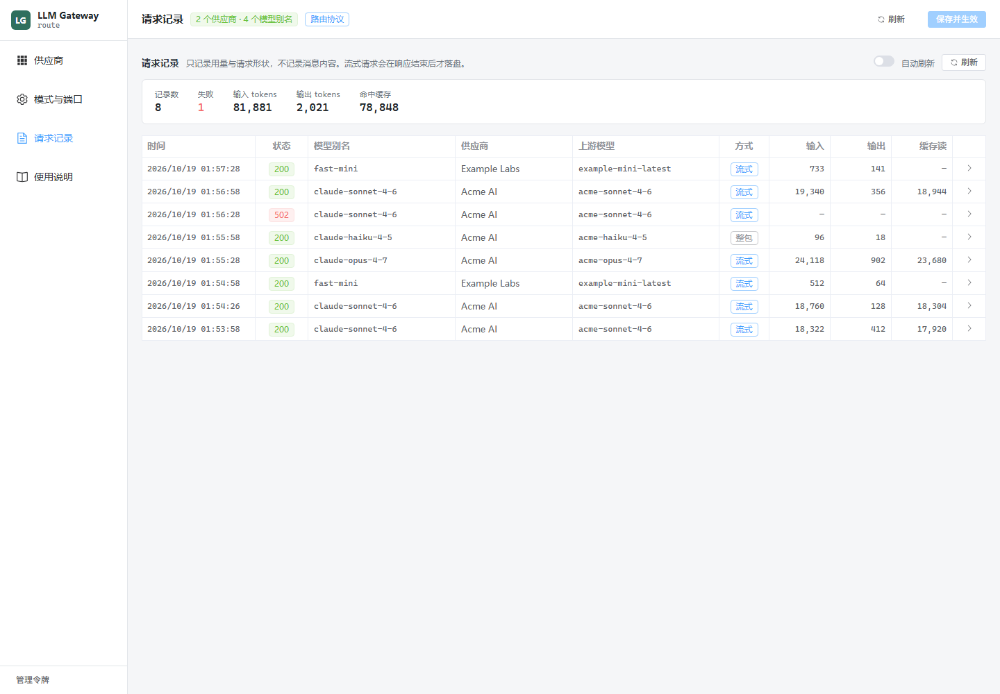
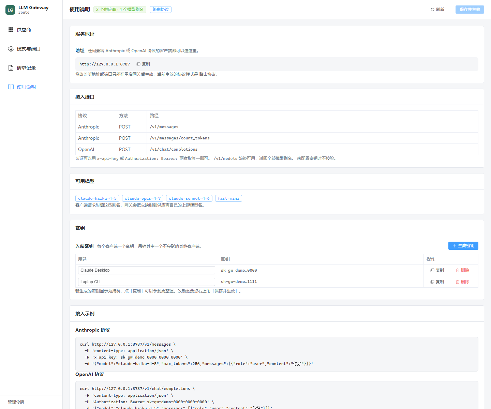

# llm-gateway

[](https://github.com/banchen21/llm-gateway/actions/workflows/ci.yml)
[](LICENSE)


**English** · [简体中文](README.zh-CN.md)

A local gateway that speaks the **Anthropic Messages API** to your clients and **either**
the Anthropic or the OpenAI Chat Completions API to your upstream providers — converting
in both directions, streaming included.

Your clients only speak one protocol. Your providers are split across two. The gateway
absorbs the difference, so an OpenAI-compatible vendor becomes an Anthropic-compatible one
and back, without the client knowing.



## Why

Every "Anthropic-compatible" endpoint is compatible in its own way. Anthropic's own client
sends fields like `thinking: {"type": "adaptive"}`, `output_config` and `context_management`
that a third-party implementation may reject with an opaque 400, and it puts a `system`-role
message *inside* `messages`, which plenty of servers refuse. The gateway normalizes those
shapes, maps model names onto whatever the provider calls them, and gives you one place to
see what actually happened.

## What it does

- **Conversion in all four directions.** Anthropic ⇄ OpenAI requests and responses, SSE
  included. Inbound protocol and upstream protocol are independent.
- **Providers and model aliases.** Add endpoints, declare their models, and map the client
  name onto the provider's own name. Unrecognized model names are reported, never silently
  rerouted.
- **A GUI, in a window or in a browser.** The same interface runs as a desktop window and
  as a page on the gateway's port.
- **Named inbound keys.** Issue one key per client and revoke them independently.
- **A request log you can read.** Model, provider, status, duration and token counts for
  every call — never message bodies.
- **Protocol modes.** Expose the Anthropic API, the OpenAI API, or both; switching takes
  effect without a restart.

## Quick start

**Desktop app** (the window runs the gateway inside it):

```bash
cd apps/desktop && pnpm install && pnpm build
cargo run -p llm-gateway-desktop
```

**Headless**, as a plain local service:

```bash
cargo run -p gateway-server
```

Either way the gateway listens on `127.0.0.1:8787` with no providers. Open the GUI, add a
provider, and it starts routing.

Point at a specific configuration file instead of the platform default:

```bash
LLM_GATEWAY_CONFIG=/path/to/config.json cargo run -p gateway-server
```

### Talking to it

```bash
# Anthropic-shaped request
curl http://127.0.0.1:8787/v1/messages \
  -H 'content-type: application/json' \
  -d '{"model":"<alias>","max_tokens":256,"stream":true,
       "messages":[{"role":"user","content":"hello"}]}'

# OpenAI-shaped request (needs a mode that serves it)
curl http://127.0.0.1:8787/v1/chat/completions \
  -H 'content-type: application/json' \
  -d '{"model":"<alias>","stream":true,
       "messages":[{"role":"user","content":"hello"}]}'
```

`<alias>` is whatever you named a model in the GUI, not the provider's own model id.

### Endpoints

| Endpoint | Available in |
|---|---|
| `POST /v1/messages` | `primary_anthropic`, `route` |
| `POST /v1/messages/count_tokens` | `primary_anthropic`, `route` |
| `POST /v1/chat/completions` | `primary_open_ai`, `route` |
| `GET /v1/models` | always |
| `GET /admin/config`, `PUT /admin/config` | always |
| `GET /admin/logs`, `GET /admin/health` | always |
| `GET /` (the GUI) | when the web GUI is enabled |

Authentication accepts either `x-api-key` or `Authorization: Bearer`. With no key
configured the gateway accepts anything, which is what lets SDK clients present an
arbitrary placeholder key.

## The four combinations

```
                 ┌──────────────────────────────┐
 Anthropic SDK ──┤ POST /v1/messages            │──▶ Anthropic-compatible provider
 OpenAI SDK    ──┤ POST /v1/chat/completions    │──▶ OpenAI-compatible provider
                 └──────────────────────────────┘
                        llm-gateway
```

| Inbound | Upstream | Works |
|---|---|---|
| Anthropic | Anthropic | ✅ pass-through with normalization |
| Anthropic | OpenAI | ✅ |
| OpenAI | Anthropic | ✅ |
| OpenAI | OpenAI | ✅ |

A request always flows `client protocol -> IR -> upstream protocol`, and a response always
flows `upstream SSE -> ModelEvent -> client SSE`. No converter knows which protocol sits on
the other side, which is what keeps the four combinations from needing four code paths.

## Configuration

`config.json` lives in the platform's config directory, or wherever `LLM_GATEWAY_CONFIG`
points. The GUI edits this file; so can you.

```jsonc
{
  "protocol_mode": "route",            // primary_anthropic | primary_open_ai | route
  "server": {
    "bind": "127.0.0.1",
    "port": 8787,
    "api_key": null,                   // legacy single key; either this or api_keys gates inbound calls
    "api_keys": [                      // one key per client
      { "id": "…", "name": "Claude Desktop", "key": "sk-gw-…" }
    ]
  },
  "web_ui": {
    "enabled": false,                  // serve the GUI on the port above
    "token": null                      // required for admin access when enabled
  },
  "default_provider_id": null,         // catch-all for unrecognized model names
  "providers": [
    {
      "id": "…",                       // assigned by the gateway if omitted
      "name": "Example",
      "protocol": "anthropic",         // anthropic | open_ai
      "base_url": "https://api.anthropic.com",
      "api_key": "sk-…",
      "enabled": true,
      "custom_headers": {},
      "models": [
        {
          "id": "…",
          "alias": "claude-opus-4-7",  // what clients ask for
          "upstream_model": "claude-opus-4-7",
          "enabled": true,
          "max_output_tokens": 8192,
          "max_tokens_field": "max_tokens",   // or max_completion_tokens
          "extra": {}                  // merged into the upstream request body
        }
      ]
    }
  ]
}
```

**`max_tokens_field`** exists because the ecosystem is genuinely split: OpenAI's reasoning
models reject `max_tokens`, while most third-party OpenAI-compatible vendors reject
`max_completion_tokens`. It defaults to `max_tokens`, which is what most compatible vendors
accept.

**`extra`** is an escape hatch for vendor-specific parameters the gateway does not model. It
cannot overwrite fields that carry the request's meaning (`model`, `messages`, `tools`,
`stream`, and the output-limit field); doing so is rejected rather than silently applied.

### Two things worth knowing

**Provider API keys are stored in plain text.** It is a local single-user tool and the keys
have to survive a round trip through the GUI to be editable. The GUI masks them on screen.
If you bind to a non-loopback address with the web GUI enabled, the gateway refuses to save
unless you set `web_ui.token`, because that same API reads and writes those keys.

**`PUT /admin/config` replaces the whole document.** A body containing only part of the
configuration clears the rest. The GUI always sends the complete document.

## The GUI

| | |
|---|---|
|  |  |

The **usage guide** page shows the address, the live endpoints, every model alias, and lets
you issue and revoke inbound keys without leaving the app.

## Development

```bash
cargo test --workspace                 # protocol and server tests
cargo clippy --workspace --all-targets
cargo fmt --check
cd apps/desktop && pnpm typecheck
```

The protocol tests replay recorded SSE against a stand-in upstream, so the conversion logic
is verifiable without credentials or network access.

See [CONTRIBUTING.md](CONTRIBUTING.md) for the layout and the review checklist.

## Not implemented

- Anthropic's `/v1/responses`-style and OpenAI's Responses API are not supported; the
  gateway speaks Messages and Chat Completions.
- `count_tokens` is an estimate derived from the request's characters, not a real
  tokenizer. The response says so in an `x-token-count: approximate` header.
- Prompt-cache breakpoints (`cache_control`) are not added to Anthropic upstream requests,
  and `prompt_cache_key` is not added to OpenAI ones. Cache fields reported *by* an upstream
  are passed through faithfully.
- Prebuilt binaries are not published yet; build from source.

## License

[MIT](LICENSE)
