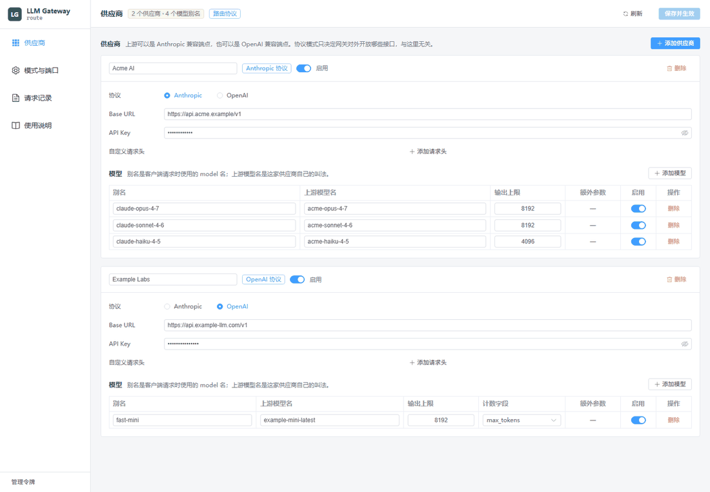

# llm-gateway

[](https://github.com/banchen21/llm-gateway/actions/workflows/ci.yml)
[](LICENSE)


[English](README.md) · **简体中文**

一个本地网关：对客户端讲 **Anthropic Messages 协议**，对上游讲 **Anthropic** 或
**OpenAI Chat Completions 协议**，两个方向都做转换，包括流式。

你的客户端只会说一种协议，而你的供应商分散在两种协议上。网关把这层差异吸收掉——
一个 OpenAI 兼容的供应商可以变成 Anthropic 兼容的，反之亦然，客户端无需知道。



## 为什么需要它

每个"Anthropic 兼容"的端点，兼容的方式都不太一样。Anthropic 官方客户端会发
`thinking: {"type": "adaptive"}`、`output_config`、`context_management` 这些字段，第三方实现
可能直接甩回一个语焉不详的 400；它还会把 `system` 角色的消息塞进 `messages` 里，不少
服务端不认。网关负责把这些形状归一化、把模型名映射成供应商自己的叫法，并给你一个
能看到实际发生了什么的窗口。

## 功能

- **四个方向全都能转。** Anthropic ⇄ OpenAI 的请求与响应，含 SSE。入站协议与上游协议互相独立。
- **供应商与模型别名。** 添加端点、声明模型，把客户端用的名字映射到供应商自己的名字。不认识的模型名会明确报错，绝不静默改道。
- **一个供应商多个密钥。** 不同账号的额度互相独立；请求会在密钥间轮转，遇到 429、401、403 自动换下一个。
- **图形界面，窗口或浏览器。** 同一套界面既跑在桌面窗口里，也跑在网关端口上。
- **命名的入站密钥。** 一个客户端一把，可单独吊销。
- **存在 SQLite 里的请求日志。** 每次调用的模型、供应商、状态、耗时和 token 数——不记录消息正文——并显示输入里命中缓存的比例，支持一键清除。
- **协议模式。** 只开 Anthropic、只开 OpenAI，或两个都开；切换无需重启。
- **从上游获取模型。** 一次调用填满模型表格，不用手敲名字。
- **自动兜底。** 别名指向的供应商拒绝服务（额度、密钥、套餐）时，按顺序尝试其他已启用的供应商，日志记录实际应答者。
- **卡顿识别。** 超过设定时间还没有首个字节的路由会被放弃、标记为缓慢两分钟，请求改由其他供应商应答——"能用但 14 秒"从不报错，只有时钟能发现它。
- **测速页。** 一键用同一段固定提示词跑完所有别名，给出延迟、耗时和每秒 token 数。

## 快速开始

预编译二进制在 [Releases](https://github.com/banchen21/llm-gateway/releases)。从源码构建：

**桌面版**（窗口内嵌网关）：

```bash
cd apps/desktop && pnpm install && pnpm build
cargo run -p llm-gateway-desktop
```

**无头模式**，作为一个普通的本地服务：

```bash
cargo run -p gateway-server
```

两种情况都默认监听 `127.0.0.1:8787`，没有任何供应商。打开界面添加一个供应商，它就开始路由了。

指定配置文件而不是平台默认位置：

```bash
LLM_GATEWAY_CONFIG=/path/to/config.json cargo run -p gateway-server
```

### 怎么调用

```bash
# Anthropic 形状的请求
curl http://127.0.0.1:8787/v1/messages \
  -H 'content-type: application/json' \
  -d '{"model":"<别名>","max_tokens":256,"stream":true,
       "messages":[{"role":"user","content":"你好"}]}'

# OpenAI 形状的请求（需要模式开放该接口）
curl http://127.0.0.1:8787/v1/chat/completions \
  -H 'content-type: application/json' \
  -d '{"model":"<别名>","stream":true,
       "messages":[{"role":"user","content":"你好"}]}'
```

`<别名>` 是你在界面里给模型起的名字，不是供应商那边的模型 id。

### 接口

| 接口 | 可用模式 |
|---|---|
| `POST /v1/messages` | `primary_anthropic`、`route` |
| `POST /v1/messages/count_tokens` | `primary_anthropic`、`route` |
| `POST /v1/chat/completions` | `primary_open_ai`、`route` |
| `GET /v1/models` | 始终可用 |
| `GET /admin/config`、`PUT /admin/config` | 始终可用 |
| `GET /admin/logs`、`DELETE /admin/logs` | 始终可用 |
| `GET /admin/health` | 始终可用 |
| `POST /admin/provider-models` | 始终可用 |
| `GET /`（界面） | Web 界面启用时 |

认证接受 `x-api-key` 或 `Authorization: Bearer`。没有配置密钥时网关放行一切，这正是各类
SDK 客户端能随便填个占位密钥的原因。

## 四种组合

```
                 ┌──────────────────────────────┐
 Anthropic SDK ──┤ POST /v1/messages            │──▶ Anthropic 兼容供应商
 OpenAI SDK    ──┤ POST /v1/chat/completions    │──▶ OpenAI 兼容供应商
                 └──────────────────────────────┘
                        llm-gateway
```

| 入站 | 上游 | 是否支持 |
|---|---|---|
| Anthropic | Anthropic | ✅ 直通并归一化 |
| Anthropic | OpenAI | ✅ |
| OpenAI | Anthropic | ✅ |
| OpenAI | OpenAI | ✅ |

请求永远走 `客户端协议 -> IR -> 上游协议`，响应永远走 `上游 SSE -> ModelEvent -> 客户端 SSE`。
没有哪个转换器知道对面是什么协议，这正是四种组合不需要四套代码路径的原因。

## 配置

`config.json` 位于平台的配置目录，或 `LLM_GATEWAY_CONFIG` 指向的位置。界面会编辑它，你也可以。

```jsonc
{
  "protocol_mode": "route",            // primary_anthropic | primary_open_ai | route
  "server": {
    "bind": "127.0.0.1",
    "port": 8787,
    "api_key": null,                   // 旧版单密钥；它与 api_keys 共同决定入站鉴权
    "api_keys": [                      // 一个客户端一把
      { "id": "…", "name": "Claude Desktop", "key": "sk-gw-…" }
    ]
  },
  "web_ui": {
    "enabled": false,                  // 在网关端口上提供界面
    "token": null                      // 启用时管理接口所需的令牌
  },
  "default_provider_id": null,         // 未匹配模型的兜底供应商
  "providers": [
    {
      "id": "…",                       // 省略时由网关分配
      "name": "Example",
      "protocol": "anthropic",         // anthropic | open_ai
      "base_url": "https://api.anthropic.com",
      "api_key": "sk-…",
      "api_keys": [                    // 同一个端点的备用账号
        { "id": "…", "name": "第二个账号", "key": "sk-…" }
      ],
      "enabled": true,
      "custom_headers": {},
      "models": [
        {
          "id": "…",
          "alias": "claude-opus-4-7",  // 客户端请求时用的名字
          "upstream_model": "claude-opus-4-7",
          "enabled": true,
          "max_output_tokens": 8192,
          "max_tokens_field": "max_tokens",   // 或 max_completion_tokens
          "extra": {}                  // 合并进上游请求体
        }
      ]
    }
  ]
}
```

**`max_tokens_field`** 之所以存在，是因为生态确实是分裂的：OpenAI 的推理模型拒绝
`max_tokens`，而多数第三方 OpenAI 兼容供应商拒绝 `max_completion_tokens`。默认是
`max_tokens`，也就是多数兼容供应商接受的那个。

**`extra`** 是给网关没有建模的厂商参数留的逃生舱。它不能覆盖承载请求语义的字段
（`model`、`messages`、`tools`、`stream` 以及输出上限字段），否则会被拒绝而不是静默应用。

### 两件需要知道的事

**供应商 API Key 以明文保存。** 这是本地单用户工具，而且密钥必须经过界面往返才能编辑。
界面在屏幕上会打码。如果你绑定到非回环地址并启用了 Web 界面，网关会拒绝保存，除非你设置了
`web_ui.token`——因为同一个接口既能读也能写这些密钥。

**`PUT /admin/config` 是整份替换。** 只包含部分配置的请求体会清空其余部分。界面永远发送完整文档。

## 代理

网关保留两条通往外网的路径——直连，和 Windows 配置的系统代理——并**优先使用最近更快的那条**。
每条路径维护一个首字节耗时的衰减平均值（失败按长时间卡顿计入）。直连在平局时胜出、也是初始默认；
代理要拿到两个样本并且快出 15% 以上，或者直连刚刚失败过，才会接管。每第 10 个请求仍会试探直连一次，
这样网络在数据背后发生变化时，直连能把偏好赢回来。

环境变量里的 `ALL_PROXY` / `HTTP_PROXY` / `HTTPS_PROXY`（含 `NO_PROXY`）照常生效，系统代理作为第二条路径。
`GET /admin/health` 返回 `proxy_from_env`、`system_proxy_available` 与 `preferred_path`，「模式与端口」页会显示当前偏好。

两条路径都失败时，网关会弹出 Windows 通知（最多每 10 分钟一次）提示检查网络或代理，并在请求日志中记录。

## 界面

| | |
|---|---|
|  |  |

**使用说明**页展示服务地址、当前生效的接口、全部模型别名，并允许你在应用内签发和吊销入站密钥。

## 开发

```bash
cargo test --workspace                 # 协议与服务端测试
cargo clippy --workspace --all-targets
cargo fmt --check
cd apps/desktop && pnpm typecheck
```

协议测试用录制的 SSE 对着一个替身上游回放，所以转换逻辑不需要凭据和网络就能验证。

目录结构与评审清单见 [CONTRIBUTING.md](CONTRIBUTING.md)。

## 尚未实现

- 不支持 Anthropic 的 `/v1/responses` 风格接口与 OpenAI 的 Responses API；网关只说 Messages 和 Chat Completions。
- `count_tokens` 是按请求字符数估算的，不是真正的分词器；响应头会带 `x-token-count: approximate` 说明这一点。
- 不会向上游注入 prompt cache 断点（Anthropic 的 `cache_control`）或 `prompt_cache_key`；上游**返回**的缓存字段会原样透传。
- 预编译二进制见 [Releases](https://github.com/banchen21/llm-gateway/releases)，覆盖 Windows、Linux 和 macOS。macOS 只提供无头服务端；桌面壳需要从源码构建。

## 许可证

[MIT](LICENSE)
